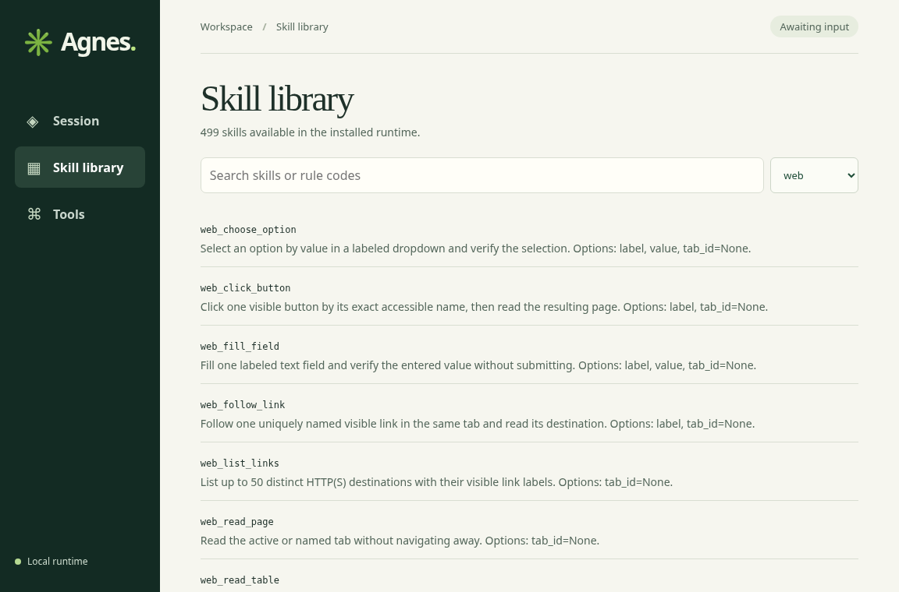
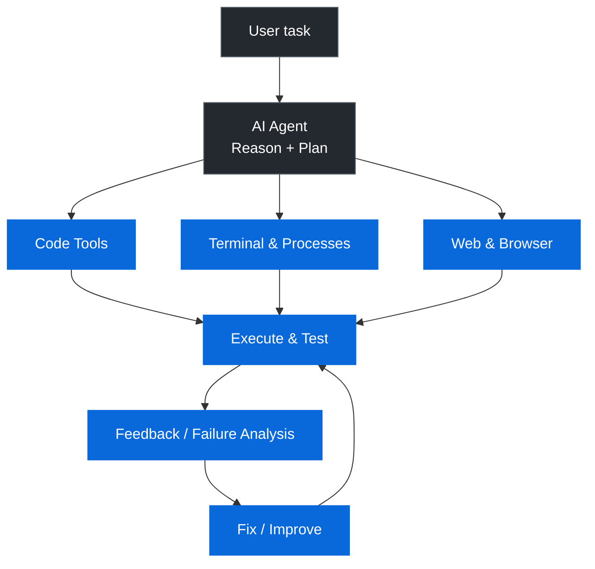
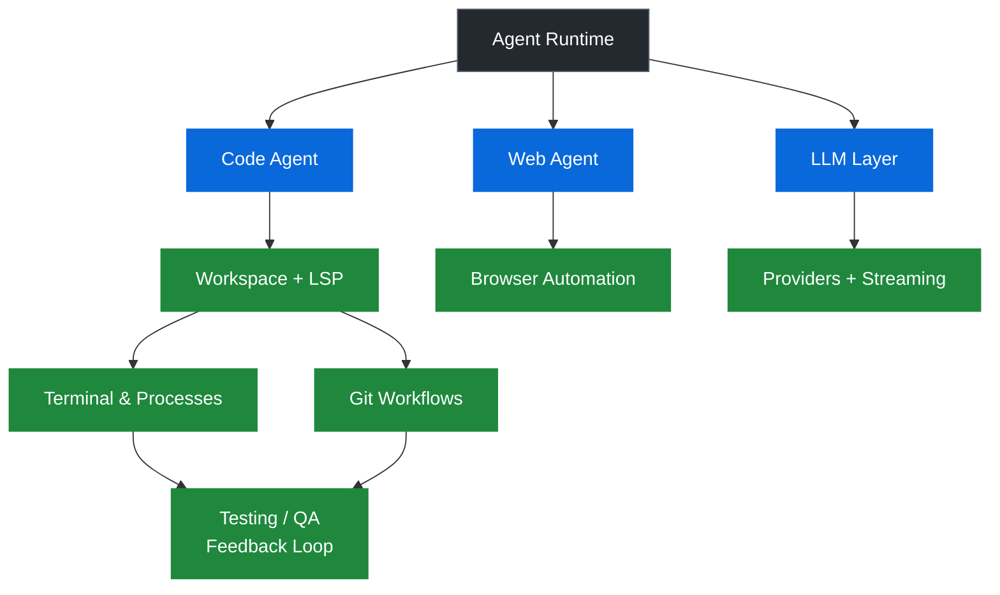

# 🤖 Advanced AI Coding Agent

> **An autonomous software-engineering agent built to work with real codebases — not just generate code.**

[](https://www.python.org/)
[](https://git-scm.com/)
[](https://www.docker.com/)
[](https://github.com/KigenIsaac/advanced-ai-agent/actions/workflows/ci.yml)

**AI Agent · Developer Tooling · Code Intelligence · Automation**

## 🚀 Quick Start

### Requirements

- Python 3.x (CI currently validates Python 3.12)
- An API key for the selected LLM provider
- Docker is optional and only needed for the Docker sandbox backend
- Playwright browser binaries are required for browser automation

### Install

Linux / macOS:

```bash
git clone https://github.com/KigenIsaac/advanced-ai-agent.git
cd advanced-ai-agent

python -m venv .venv
source .venv/bin/activate

python -m pip install --upgrade pip
python -m pip install -r requirements.txt
python -m playwright install
```

Windows PowerShell:

```powershell
git clone https://github.com/KigenIsaac/advanced-ai-agent.git
cd advanced-ai-agent

py -m venv .venv
.\.venv\Scripts\Activate.ps1

py -m pip install --upgrade pip
py -m pip install -r requirements.txt
py -m playwright install
```

### Configure

Copy `.env.example` to `.env` and provide your API key:

```text
AGNES_API_KEY=your_api_key_here
AGNES_PROVIDER=agnes
AGNES_MODEL=agnes-3.0-flash
```

The repository ignores `.env` so credentials should not be committed.

### Run

```bash
python main.py
```

On Windows, `py main.py` can be used instead.

The CLI lets you select a provider and open or create a project workspace. Use `--help` to inspect available runtime options.

### Browser frontend

```bash
python -m pip install -r requirements.txt
python main.py --frontend
```



The local server opens a private URL in your default browser. Use the same provider credentials, project directory, and routing flags as the terminal. To open a named project directly, run `python main.py --frontend --project my-project`. To print the URL without launching a browser, add `--no-open-browser`. The default port is assigned automatically; `--frontend-port 8765` selects a fixed port.

Use **Session** to select or create a project, send a task, watch streamed replies and tool activity, or start a swarm turn. **Skill library** searches the installed catalog, and **Tools** toggles capabilities on the current runtime. Slash commands, including `/history`, `/resume`, and `/export`, use the same handlers and saved files as the terminal. Reloading the tab reconnects to the current session.

Each server process serves one agent session on IPv4 loopback. Keep its tokenized URL private. `/exit` ends the agent session and leaves the transcript visible; Ctrl+C in the launching terminal stops the server.

### Run tests

Install development dependencies:

```bash
python -m pip install -r requirements-dev.txt
pytest -q
```

On Windows:

```powershell
py -m pip install -r requirements-dev.txt
py -m pytest -q
```

The test suite covers configuration behavior plus deterministic workspace, test-runner, failure-parsing, and provider-utility components. No API key is required to run the tests.

---

## Engineering skills

The agent can discover 810 skills with `skill_catalog` and run them with `skill_run` in individual sessions and swarm workers. The catalog includes 63 document operations and reports, 359 Python checks powered by Ruff, 48 ANSI SQL checks powered by SQLFluff, six combined reviews, 23 browser, document and repository workflows, 49 system design skills, and 262 engineering assurance skills. Each analyzer check selects one named rule. A combined review runs its selected rules together in one process.

Discovery supports group, keyword, or rule-code searches. For example, `{"query":"F821"}` finds the undefined-name check. Results include a total and a continuation offset. The default page holds 20 entries. The model receives two tool schemas regardless of catalog size.

| Combined review | Example request |
| --- | --- |
| `review_python_correctness` | Check this module for likely runtime errors and exception-handling mistakes. |
| `review_async_services` | Inspect this async handler for blocking calls, logging and exception issues. |
| `review_test_quality` | Review the assertions, fixtures and markers in this pytest file. |
| `review_python_maintenance` | Find inefficient operations and control flow that could be simplified. |
| `review_python_api` | Check the annotations, naming and parameters in this module. |
| `review_sql_quality` | Inspect this ANSI SQL query for ambiguous references, join issues and layout problems. |

Analyzer results include a status, total diagnostic count, and the first 50 findings with rule IDs and source positions. Source parsing errors, timeouts and unavailable analyzers are reported separately. The checks use fixed rule settings and a 15-second process timeout. SQL analysis reads raw text using the ANSI dialect. Python checks target Python 3.12.

### Engineering a system

The `project` group contains 317 skills. The 262 [engineering assurance skills](docs/engineering-assurance.md) evaluate scalability, accuracy, safety and reliability. The other 55 cover planning (9), relational storage (11), API contracts (9), state machines (11), capacity and reliability (9), and repository inspection (6). Open the [engineering skill guide](docs/system-engineering.md) for every skill name, input formats, units, and a runnable example. Discover available operations with `skill_catalog` and `{"group":"project"}`; follow `next_offset` for subsequent pages.

### Browser, document and project workflows

Search `skill_catalog` with group `web`, `document` or `project` for the available names and arguments. Supply those arguments in `options` when calling `skill_run`.

| Group | Example skill call | What it returns |
| --- | --- | --- |
| Web | `{"skill":"web_visit","options":{"url":"https://example.org"}}` | Page title, URL, status, headings and main text. Follow links, extract tables, or interact with named controls in the same tab. |
| Document | `{"skill":"document_append_section","options":{"path":"minutes.docx","heading":"Actions","text":"Review invoices","output":"revised.docx"}}` | A new Word file. Other workflows create Word files, replace plain paragraph text, read tables, export Markdown, and extract selectable PDF text. |
| Project | `{"skill":"project_api_diff","options":{"before":"old.py","after":"new.py"}}` | Added, removed and changed public Python declarations. Git workflows inspect recent changes, project inventory and likely related tests. |

Browser actions use the active tab or an explicit `tab_id`. A button click can submit a form. Document output paths must be new and inside the project workspace. Install the browser for the integration suite with `python -m playwright install chromium --only-shell`.

The original document operations and reports cover these formats.

| Group | Example task | Report skill |
| --- | --- | --- |
| Python | Locate mutable defaults, bare exception handlers and missing docstrings | `python_review` |
| CSV | Profile imports for missing cells, duplicate records and constant columns | `csv_quality_report` |
| JSON | Measure nesting, count types and locate null or empty values by JSON Pointer | `json_structure_report` |
| Text | Check conflict markers, indentation, trailing whitespace and line endings | `text_patch_preflight` |
| INI | Review effective settings, including inherited defaults | `ini_config_review` |
| Node package manifests | Inspect engine constraints, dependency overlap, paired scripts and workspaces | `package_install_review` |
| JUnit XML | Summarize test outcomes and extract individual failure messages | `junit_triage` |

For example, ask the agent “Triage reports/junit.xml and show me which tests failed.” It can call `skill_run` with `{"skill":"junit_triage","path":"reports/junit.xml"}`. A path uses the enabled project workspace and preserves UTF-8 text and line endings. Inline documents use the `text` argument. Each call accepts up to 32,768 characters and returns a result or a structured error. Python analysis also limits token count. Install the pinned analyzer dependencies with `python -m pip install -r requirements.txt`.

## Overview

Most LLM applications stop at producing text or code suggestions.

This project explores a different approach:



The goal is to give an AI the tools required to **inspect, change, execute, test, debug, and manage software-engineering work**.

---

## ✨ Core Capabilities

### 🧠 Codebase Intelligence

The agent can work with existing projects instead of assuming that it is starting from an empty directory.

Capabilities include:

- Project structure inspection
- File and directory operations
- Search and grep
- Regular-expression search
- Symbol discovery
- Functions and classes
- Imports and exports
- Dependency inspection
- AST-based code inspection
- Module relationships
- LSP-powered code intelligence
- Project context and engineering conventions

---

### ✏️ Code Editing & Refactoring

The agent provides structured ways to modify software:

- Create files
- Read files
- Edit files
- Append content
- Delete files
- Move and copy files
- Apply patches
- Preview changes
- Replace ranges
- Insert and delete code
- Rewrite files
- Rename symbols
- Manage imports
- Extract or inline code
- Split files
- Simplify code
- Remove dead code
- Track and revert edit history

The emphasis is on **controlled software modification**, rather than blindly overwriting files.

---

### 🖥️ Terminal & Process Execution

The agent can interact with the development environment through process tooling.

It supports:

- Foreground processes
- Background processes
- Process inspection
- Process termination
- Waiting for processes
- Execution timeouts
- stdout/stderr capture
- Environment handling
- Unix process groups
- Cross-platform execution

This allows the agent to move from:

```text
"Here is some code."
```

to:

```text
"Here is the code → I executed it → observed the result → diagnosed the failure → changed it → tested it again."
```

---

## 🧪 Testing & Quality

The project includes tooling for discovering and executing tests across multiple ecosystems.

Supported test tooling includes detection/execution for:

- pytest
- unittest
- Jest
- Vitest
- Mocha
- Cargo
- Go

It also provides capabilities for:

- Test discovery
- Individual test execution
- Failure extraction
- Coverage information
- Test scaffolding
- Static analysis
- Security scanning
- Complexity analysis
- Dead-code hints

Static/security tooling includes integrations for tools such as:

- Ruff
- Flake8
- Pylint
- ESLint
- Clippy
- `go vet`
- Bandit
- Semgrep
- Trivy
- Radon
- Lizard

---

## 🔀 Git & Software Workflows

The agent can interact with Git-based development workflows.

Capabilities include:

- Repository status
- Diffs
- Commit history
- Commit inspection
- Branch management
- Add/commit
- Amend
- Stash
- Revert
- Reset
- Merge
- Rebase
- Cherry-pick
- Blame/history
- Pull/push
- Pull request creation and updates

This makes Git part of the agent's working environment rather than an external manual step.

---

## 🌐 Browser & Web Agent

The project also includes browser automation and web-research capabilities.

The browser layer supports workflows such as:

- Navigation
- Clicking
- Typing
- Forms
- Scrolling
- Selection
- Uploads
- JavaScript execution
- Screenshots
- Tabs
- Frames
- Network inspection
- Downloads
- Cookies
- Local storage
- Accessibility trees
- Semantic snapshots
- Element discovery
- Challenge detection
- Navigation recovery

The system can also perform web, news, image, and shopping research.

---

## 🧩 LSP & Code Intelligence

Language Server Protocol capabilities allow the agent to reason about code at a deeper level than plain text search.

Supported operations include:

- Definitions
- References
- Hover information
- Rename
- Document symbols
- Workspace symbols
- Diagnostics

This provides a foundation for more reliable code navigation and refactoring.

---

## 🤖 Multi-Provider LLM Architecture

The project uses a provider abstraction so the agent is not tied to a single model vendor.

The provider layer supports integrations across multiple providers and local/model-routing environments, including:

- OpenAI
- Anthropic
- Gemini
- DeepSeek
- Groq
- Mistral
- Together
- Cohere
- Perplexity
- Fireworks
- xAI
- OpenRouter
- Ollama
- Agnes
- Local providers

The provider layer also addresses practical production concerns such as:

- Retries
- Transient network failures
- Rate limits
- `Retry-After`
- Multiple API keys
- Provider/key cooldowns
- Streaming
- Malformed responses
- Tool-call argument normalization
- Conversation-history repair

---

## 🧠 Persistent Project Context

Long-running software tasks require more than a single prompt.

The agent can maintain project-level context including:

- Project information
- Architecture
- Engineering conventions
- Recent changes
- Repository documentation

It can inspect project guidance files such as:

```text
AGENTS.md
CLAUDE.md
.cursorrules
CONTRIBUTING.md
README.md
```

This allows the agent to adapt its behavior to the project it is working on.

---

## 🔐 Sandboxed Execution

The project includes execution backends designed to separate agent-controlled work from the host environment.

### Subprocess backend

Useful for local development and direct execution.

### Docker backend

Provides containerized execution with the workspace mounted into the container.

> **Security note:** this is an engineering sandbox, not a claim of a hardened security boundary. Untrusted workloads should be isolated further and run with appropriate resource, network, filesystem, and privilege restrictions.

---

## 🚀 Deployment & Monitoring

The deployment layer contains workflows for detecting and interacting with common deployment environments, including:

- Vercel
- Netlify
- Fly.io
- Render
- Docker
- GitHub Actions
- Heroku
- Kubernetes

It also provides hooks for:

- Deployment
- Deployment status
- Logs
- Rollback
- Health monitoring
- Metrics

Destructive deployment actions can be gated behind explicit authorization.

---

## 🏗️ Architecture

At a high level, the project is organized around several cooperating subsystems:



---

## 📁 Repository Structure

```text
.
├── codeagent/
│   ├── sandbox.py
│   ├── deploy.py
│   ├── testing.py
│   └── ...
├── llm_providers/
├── webagent/
├── main.py
├── providers.json
├── requirements.txt
├── requirements-dev.txt
├── .env.example
├── .github/workflows/ci.yml
├── test_custom_agent_config.py
└── test_core_components.py
```

The repository is intentionally modular around the major capabilities required by an autonomous software-engineering workflow.

---

## 🎯 Example Workflow

A typical agent task can follow a loop like:

```text
1. Understand the task
2. Inspect the repository
3. Identify relevant files
4. Inspect dependencies and architecture
5. Plan the change
6. Modify the code
7. Run tests
8. Analyze failures
9. Apply fixes
10. Re-run validation
11. Inspect the final diff
12. Commit or prepare the change
```

The important part is the **feedback loop**.

The agent is not considered successful merely because it generated code. It should be able to observe what happened after execution and respond to the result.

---

## 🧪 Project Philosophy

This project explores a broader direction for AI-assisted software engineering:

```text
LLM
 │
 ├── Understand
 │
 ├── Plan
 │
 ├── Use tools
 │
 ├── Execute
 │
 ├── Observe
 │
 ├── Test
 │
 ├── Diagnose
 │
 └── Improve
```

The objective is to move from **AI that writes code** toward **AI that can participate in the software-engineering process**.

---

## ⚠️ Engineering Considerations

This is an advanced experimental system and should not be treated as a universally safe autonomous production agent.

Important considerations include:

- Agent-generated code must be reviewed.
- Subprocess execution is not equivalent to secure isolation.
- Docker configurations should be hardened for untrusted workloads.
- Browser automation can interact with external systems and should be permissioned appropriately.
- Deployment actions should be protected by explicit authorization.
- Credentials and API keys must never be committed to the repository.
- Network access and filesystem permissions should be restricted when running untrusted tasks.

---

## 🛠️ Technology

**Language:** Python

**Core areas:**

- LLM orchestration
- Tool calling
- Code intelligence
- LSP
- AST inspection
- Terminal/process execution
- Testing
- Static analysis
- Security scanning
- Git automation
- Browser automation
- Docker execution
- Deployment workflows
- Multi-provider AI

---

## 📌 Why This Project Exists

Software engineering involves much more than generating source code.

A real engineering task can require:

```text
Understand the system
        ↓
Find the right files
        ↓
Change the implementation
        ↓
Run the software
        ↓
Observe failures
        ↓
Debug
        ↓
Test
        ↓
Review the diff
        ↓
Deliver
```

This project is an exploration of what happens when an AI system is given the tools required to participate in that complete loop.

---

## 👤 Author

**Isaac Kigen**

Software Developer focused on:

- AI agent engineering
- LLM applications
- Backend systems
- Developer tools
- Automation
- Real-time AI

---

## ⭐ Status

This project is actively evolving as an exploration of autonomous software-engineering systems.


## Lower-cost Chinese model APIs (local orchestration)

The coding agent runs on your own computer. **DeepSeek, Qwen and Kimi inference is remote** when you use their APIs; prompts, selected code and tool context can leave your device. Ollama remains available for fully local inference.

```bash
# DeepSeek (current API model)
export AGNES_PROVIDER=deepseek
export DEEPSEEK_API_KEY=your_secret_key
python main.py --max-rounds 20

# Qwen via Alibaba Cloud Model Studio
export AGNES_PROVIDER=qwen
export DASHSCOPE_API_KEY=your_secret_key
export QWEN_BASE_URL=https://YOUR_WORKSPACE_ID.ap-southeast-1.maas.aliyuncs.com/compatible-mode/v1
python main.py --max-rounds 20

# Kimi via Moonshot AI
export AGNES_PROVIDER=kimi
export MOONSHOT_API_KEY=your_secret_key
python main.py --max-rounds 20
```

On Windows PowerShell, use `$env:AGNES_PROVIDER="deepseek"` syntax instead of `export`. Alternatively configure the matching variables in a **local, uncommitted** `.env` file.

- The default Qwen base URL in `providers.json` is the older international compatibility endpoint. **Prefer `QWEN_BASE_URL` set to your actual regional workspace endpoint**, as documented by Alibaba Cloud; API keys must match that region.
- `--provider` selects the model vendor. `--model` and `--base-url` explicitly override its defaults.
- Credentials resolve in this order: explicit `--api-key`/`--api-keys`, selected provider key (`DEEPSEEK_API_KEY`, `DASHSCOPE_API_KEY`, or `MOONSHOT_API_KEY`), then generic `AGNES_API_KEY`. Keys from different vendors are never automatically mixed.
- Use `--max-rounds 20` or `AGNES_MAX_ROUNDS=20` to reduce runaway agent loops and API spend. This is **not** a monetary spending limit; configure provider account budgets separately.
- For `--provider ollama` or `local`, a keyless endpoint is accepted only on loopback (`localhost`, `127.0.0.1`, or `::1`).
- API model availability and prices change; verify models with the provider before spending. Models listed here are starter defaults, not a guarantee of superior coding benchmark scores.

Official references: [DeepSeek API pricing and models](https://api-docs.deepseek.com/quick_start/pricing/), [Alibaba Model Studio OpenAI compatibility](https://www.alibabacloud.com/help/en/model-studio/qwen-api-via-openai-chat-completions), [Kimi provider API](https://www.kimi.com/code/docs/en/kimi-code-cli/configuration/providers).


## Smart routing and daily API budget (optional)

1. Copy `routing.example.json` to a trusted location outside the project being edited.
2. Set each route's actual provider model, endpoint and current input/output rates. Example rates are placeholders, not live pricing or measured model rankings.
3. Set the provider-specific keys in your environment. Use `--provider deepseek` (or another configured primary provider) and explicitly enable routing:

```bash
python main.py --provider deepseek --routing-config /absolute/path/routing.json
```

Alternatively put the config in your agent home directory (default `~/.agnes/routing.json`). Routing configuration is not loaded implicitly from the repository being edited. Only use trusted configuration and API endpoints. Prompts and selected source code are sent to the chosen remote provider. Do not use cloud routes for secrets or confidential code without authorization.

The planner uses the planning route, worker selection uses the actual work brief, and the summarizer uses the review route. Ordinary turns are classified by task keywords. Missing specialized routes fall back to the configured general route, if available. Selection is heuristic, not proof of superior model quality. `/routes` lists routes, `/budget` shows the persistent UTC-day estimate. The ledger includes serialized messages and tool schemas in reservations, retains reservations when usage is missing, and disables automatic paid retries when a cap is configured. Ollama/local loopback routes do not incur API token charges in the ledger. This is not a provider billing guarantee; configure account-level limits separately. The example budget is USD 2 per day, not an imposed default.

### Reproducible coding smoke benchmark

Use a disposable VM or similarly isolated environment with only the required API credentials. The runner executes agents and their resulting code; a temporary directory is not a hardened sandbox. The following example is for a POSIX shell; adjust the paths and JSON quoting for Windows.

```bash
python benchmark_agents.py \
  --agent local-agent '["/absolute/path/.venv/bin/python","/absolute/path/main.py","--provider","deepseek","--routing-config","/absolute/path/routing.json","--home","{home}","--no-web","--max-rounds","20","--prompt","{prompt}"]' \
  --agent claude '["claude","--print","{prompt}"]' \
  --out benchmark-results --repeat 3 --timeout 600
```

The reference CLI must be installed and authenticated, and configured to permit editing the disposable benchmark workspace without interactive prompts. Do not grant it access to unrelated files. Each case gets an independent workspace and agent home; the evaluator checks actual behavior rather than trusting a completion claim. This runs paid requests if configured; the agent's temporary home has an independent ledger per case, so the example daily limit is **per case**, not a shared benchmark-wide cap. Provider account limits remain important.

The three initial tasks cover decimal arithmetic, stable deduplication and path validation. Output includes agent/check logs, JSON pass/fail results, runtime, and estimated ledger cost if present; reference CLI costs are unknown unless independently measured. This is a small smoke benchmark, not SWE-bench or proof of superiority over Claude Code. Expand to representative multi-file tasks before drawing conclusions. No paid benchmark is run automatically in CI.

### VPS web research

Search works even when Chromium fails to launch. Set `WEB_SEARCH_MODE=free` in
the VPS process environment to exclude SerpAPI from routing. With a Tavily key
or SearXNG endpoint configured, the same free-provider route is automatic.

* Set `SEARXNG_URL` to a trusted, self-hosted SearXNG base URL with JSON output
  enabled for search without per-query API fees. Hosting and network costs apply.
* In Settings → Service → Search and read · Tavily, enter a **free-plan** key,
  or set `TAVILY_API_KEY` on the VPS. Keep pay-as-you-go disabled in Tavily.
  The agent uses basic search and basic extraction. The application cannot
  detect whether the account attached to a key allows paid usage.
* Search tries SearXNG first, then Tavily for first-page web/news queries,
  then the keyless DuckDuckGo HTML endpoint. DuckDuckGo availability varies.
  The result names the backend that answered. The legacy SerpAPI path remains
  available when these integrations and free mode are unset.
* Use the browser tool's `read_url` action to send a public page URL to Tavily
  and retrieve text without a local browser. Interactive actions such as
  clicking, typing, and screenshots still require working Chromium.
